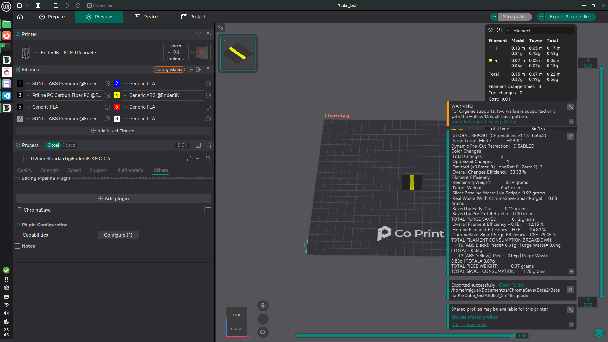

<div align="center">
  

  
  
  
</div>

Slash multi-color purge waste via Early-Cut & Dynamic Pre-Cut Retraction. ChromaSave optimizes color transitions in OrcaSlicer for single-nozzle multi-color 3D printers (Klipper, Creality K2 Series, Creality SPARKX i7 & Bambu Lab), consuming residual melt-zone filament inside hidden zones before purging to maximize material savings without compromising print quality.

# ChromaSave (v1.2.0)

**ChromaSave** is an open-source **OrcaSlicer** post-processing plugin and CLI tool designed to minimize multi-color purge waste on single-head multi-color 3D printers—including **Klipper** systems (such as CoPrint3D ChromaSet / KCM-Set with ChromaHead), **Creality K2 Series** (`K2 Plus`, `K2`, `K2 Pro` with CFS), **Creality SPARKX i7**, and **Bambu Lab** printers (A1, A1 Mini, P1P, P1S, X1C).

## What's New in v1.2.0

* **Creality K2 Series Support — K2 Plus, K2, K2 Pro (Beta):** Full CFS post-processing via `SmartPurge_K2.cfg` (`SMARTPURGE_K2_CUT` & `SMARTPURGE_K2_FLUSH`) supporting both `HYBRID` and `BUCKET_ONLY` (no prime tower) modes, Dynamic Pre-Cut Retraction (`RETRACT_BEFORE_CUT`), and a `76.1 mm` UI preset.
* **Layer 1 Toolchange Detection Fixes:** Resolved 3 parser edge cases that previously caused Layer 1 (`TC #1`) toolchanges to be missed across profiles.

*(See [CHANGELOG.md](./CHANGELOG.md) for v1.1.1 and earlier release notes.)*

## Platform Support & Maturity

| Platform / Feature | Status in `v1.2.0` |
| :--- | :--- |
| **Klipper** (*Early-Cut* + *Dynamic Pre-Cut Retraction* + `SmartPurge.cfg`) | **Stable** *(Physically validated)* |
| **OrcaSlicer HTML Config UI & Passive `DualLogger`** | **Stable** |
| **Creality K2 Series — K2 Plus / K2 / K2 Pro (CFS)** (`SmartPurge_K2.cfg` + Dynamic Pre-Cut Retraction) | **Beta** *(G-code verified; community physical testing)* |
| **Creality SPARKX i7** (*Early-Cut* + Native `M8200 R` Pre-Cut Retraction + Multi-Chunk Purge) | **Beta** *(G-code verified; community physical testing)* |
| **Bambu Lab** (*Early-Cut* + Multi-Chunk Purge) | **Beta** *(Community validation)* |
| **Bambu Lab** (*Dynamic Pre-Cut Retraction*) | **Experimental** |

## 🧠 The Concept & How It Works

After every cut, a filament plug remains between the cutter blade and the nozzle tip (e.g., `76.1 mm` on K2 Series, `64.857 mm` on ChromaHead, `63.2 mm` on SPARKX i7, `44.5 mm` on Bambu X1/P1, `38.25 mm` on Bambu A1). ChromaSave shifts the cut earlier in the G-code (**Early-Cut**) so the printer consumes that plug inside hidden zones, and dynamically retracts any unrecovered gap before cutting (**Pre-Cut Retraction**). Residual transition volume is then purged accurately based on OrcaSlicer's flush matrix.

<p align="center">
  
</p>

### Factory vs. ChromaSave Workflow

<p align="center">
  
</p>

<p align="center">
  
</p>

*Complementary to OrcaSlicer's built-in "Flush into objects' infill / support / object" options.*

## 🛠️ Installation & Configuration (OrcaSlicer)

* **Prerequisites:** OrcaSlicer v2.5.0+ and a supported single-nozzle multi-color printer. Enabling **Prime Tower** (`Process -> Others -> Prime tower`) is recommended for transition stability.
1. Install and activate **ChromaSave** directly from **OrcaCloud**, or load `chromasave-1.2.0-py3-none-any.whl` from [Releases](https://github.com/deathstroke-co/ChromaSave/releases) in the OrcaSlicer **Plugins** manager.
2. Go to **Process -> Others -> Slicing Pipeline Plugin**, add **ChromaSave**, and click **Configure**.
3. Select your printer preset, adjust thresholds and **Safety Zones**, and click **Save Configuration**:

<p align="center">
  
</p>

<p align="center">
  
</p>

### Key Parameters

| Parameter | Default | Description |
| :--- | :--- | :--- |
| **Remaining Length (`len`)** | `64.857 mm` | Cutter-to-nozzle length (presets: K2 Series `76.1`, ChromaHead `64.857`, SPARKX i7 `63.2`, Bambu X1/P1 `44.485`, Bambu A1 `38.249`). |
| **Safety Margin (`sm`)** | `10.0 mm` | Buffer subtracted from `len` (`TARGET = len - sm`) to prevent color bleed (`20 mm` ChromaHead, `10–15 mm` K2 / SPARKX / Bambu). |
| **Min Saving / Skip Purge** | `3.0 / 2.0 mm` | Minimum Early-Cut recovery required (`min_saving`) and residual chute purge threshold skipped (`skip_purge`). |
| **Purge Target (`purge_target`)** | `hybrid` | `hybrid` discounts prime tower extrusion from chute purge; `bucket_only` sends all residual purge to the chute. |
| **Dynamic Pre-Cut Retraction** | `false` | Retracts filament before cutting to recover the remaining gap up to `TARGET` (capped by `max_pre_cut_retract`, default `18.0 mm`). |
| **Retraction Search / Safety Zones** | `true` | Locks cuts onto existing retractions/Z-hops (`sre`/`rem`) and restricts cuts to checked internal zones (`aipc`). |

## 🚀 Klipper Setup (Stable)

1. Copy [SmartPurge.cfg](./klipper_configs/) into `~/printer_data/config/`, configure your purge/wipe coordinates (`variable_purge_x`, `variable_purge_y`, `variable_wipe_dist`) and optional hardware (`pulse_cool_fan`, `filament_sensor`, `aux_fan`), and include it in `printer.cfg`:
   ```ini
   [include SmartPurge.cfg]
   ```
   *(Comment out stock `FILAMENT_CHANGE` in `cp_macro.cfg` if using the optimized macro.)*
2. **OrcaSlicer Filament Start G-code:**
   ```gcode
   ; Filament gcode
   {if layer_num >= 0}
      PURGE_IN_TRASH
   {endif}
   ```
3. **OrcaSlicer Machine Change Filament G-code:**
   ```gcode
   FILAMENT_CHANGE LAYER_NUM=[layer_num] NEXT_EXTRUDER=[next_extruder] MATERIAL=[filament_type]
   ```

<p align="center">
  
</p>

## 🔬 Creality K2 Series Setup — K2 Plus / K2 / K2 Pro (Beta)

ChromaSave auto-detects K2 Series CFS G-code (`K2_CFS`) and orchestrates Early-Cut and dynamic chute purging via `SmartPurge_K2.cfg`:
1. Copy [SmartPurge_K2.cfg](./klipper_configs/) into your K2 Klipper config directory and add `[include SmartPurge_K2.cfg]` to `printer.cfg`.
2. Select the **Creality K2 Series (`76.1 mm`)** preset in the UI, set `sm` to `10–15 mm`, and choose `hybrid` or `bucket_only`.
3. Optionally enable `Dynamic Pre-Cut Retraction` (default max `18.0 mm`) to pass `RETRACT_BEFORE_CUT=<mm>` to `SMARTPURGE_K2_CUT`.

## 🔬 Creality SPARKX i7 & Bambu Lab Setup (Beta)

Both ecosystems are auto-detected (`M8200` for SPARKX i7; `M620 S` for Bambu Lab)—no custom printer macros required.
1. **Disable Native Long Retraction:** Turn **OFF** `Long retraction when cut` in OrcaSlicer (printer & filament profiles). If left ON, ChromaSave detects `M8200 R E-` / `M620.11 S1` and safely omits optimization (`[OMITTED: LONG_RETRACT]`) to prevent double-retraction.
2. Select your preset (`63.2 mm` SPARKX i7, `44.485 mm` Bambu X1/P1, `38.249 mm` Bambu A1), set `sm` to `10–15 mm`, and leave `purge_target` on `hybrid`.
3. Multi-chunk chute purging (`<= 45.0 mm`) is applied automatically. Preview the G-code and monitor the first toolchanges during beta testing.

## 📝 Optional Persistent Logs (No Full Access Needed)

Every G-code file includes the full `GLOBAL REPORT` at the bottom. For persistent history/console logs without granting *Full access*:
1. Manually create `~/chromasave_logs`.
2. In OrcaSlicer (**Plugins -> chromasave -> Permissions -> File system -> Read and write**), add `/path/to/your/home/chromasave_logs/*`.

## Feedback, Support & License

* **Issues:** Open a [GitHub Issue](https://github.com/deathstroke-co/ChromaSave/issues) with your printer model, firmware, materials, and `GLOBAL REPORT`.
* **Support:** [](https://ko-fi.com/luismlara)

Licensed under **GNU AGPLv3** — see [LICENSE](LICENSE). Copyright (C) 2026 **Luis Miguel Lara** (`deathstroke-co`).