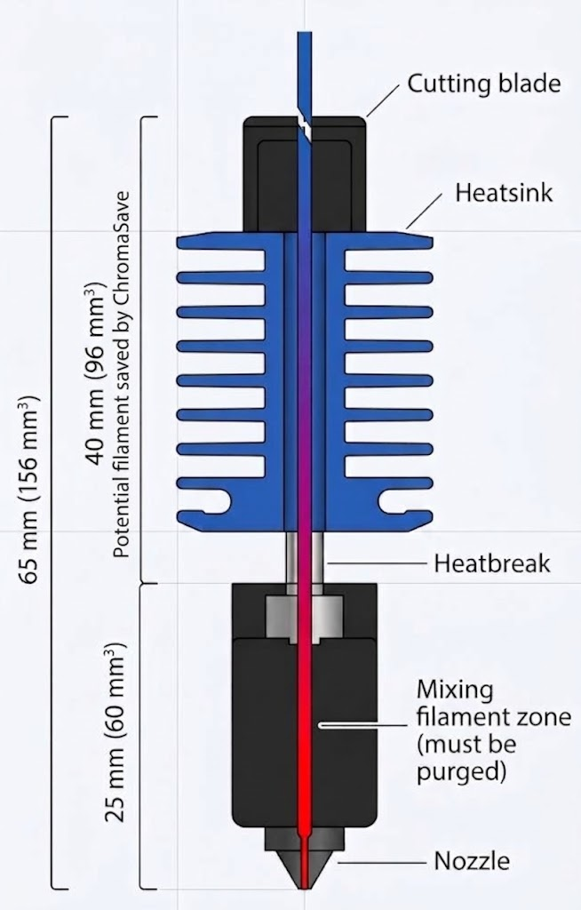
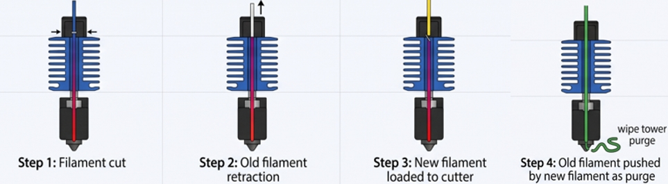
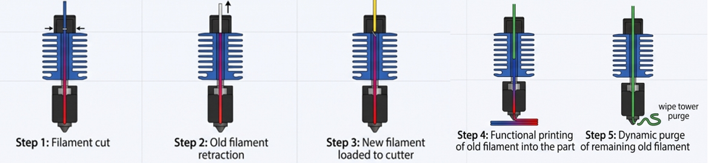
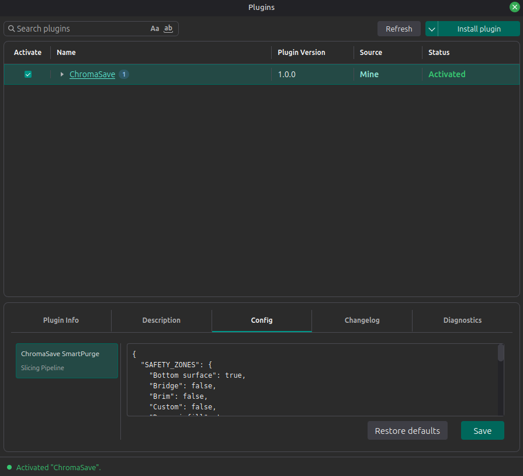
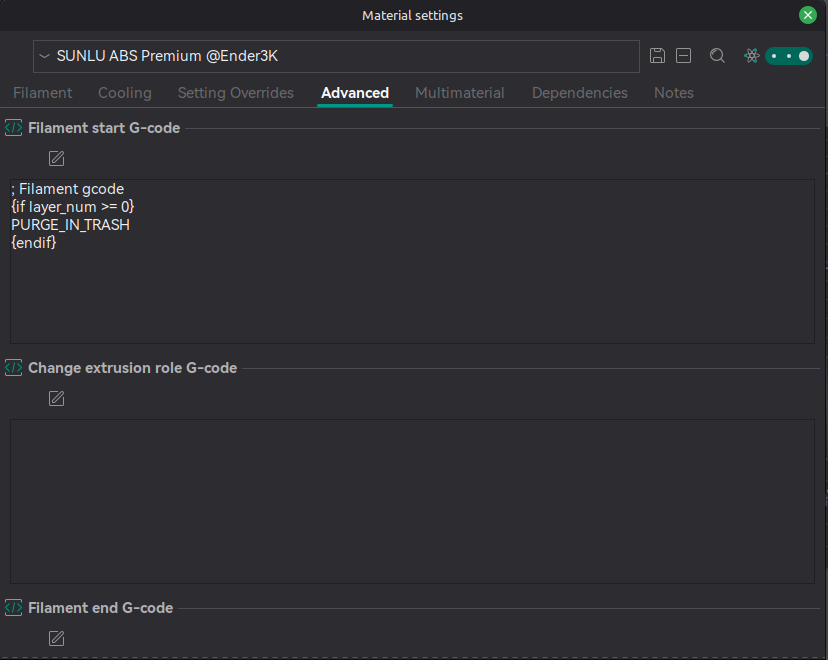
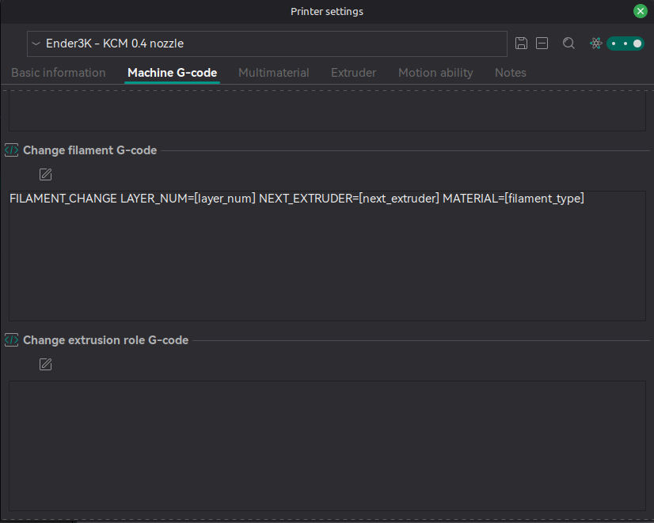
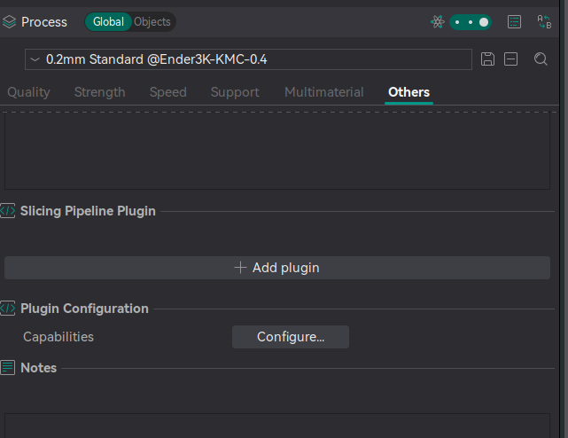
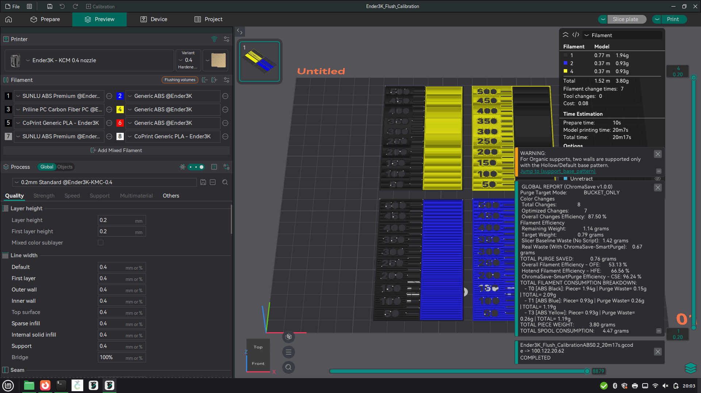
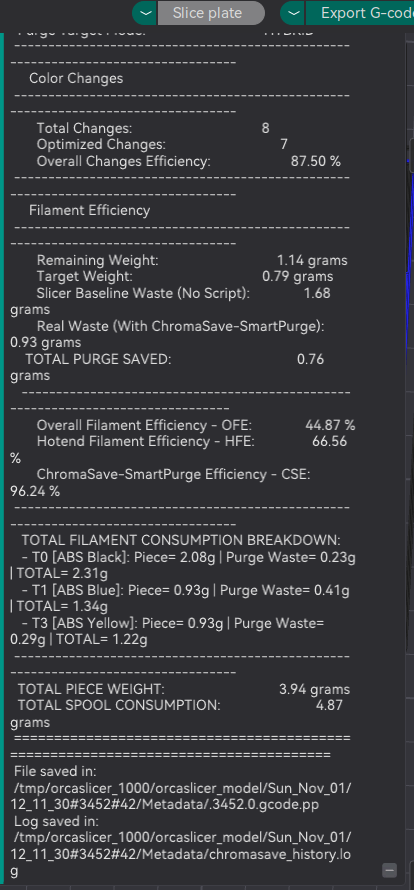

<div align="center">
  
  <p><i>Advanced G-code post-processing plugin for reducing filament waste in multi-color 3D printing.</i></p>

  
  
  
</div>

**ChromaSave** is a post-processing (slicing pipeline) plugin designed to reduce filament waste during color changes in 3D printers equipped with single-head, multi-color systems—such as the ChromaSet and KCM-Set systems from Coprint3D, which utilize the ChromaHead print head.

## 🧠 The Concept

In every color change, there is a portion of filament that could be saved. The remaining length in the ChromaHotend after cutting is 64.87mm (156 mm³), and around 40 mm of this could be saved and printed instead of being purged into a wipe tower or a bucket. For example, if you are printing a model with 300 color changes, there will be 12,000 mm of filament that could potentially be saved. ChromaSave tries to save the maximum quantity of that filament.

<p align="center">
  
</p>

## ⚙️ How It Works

ChromaSave reads the G-code generated by OrcaSlicer and identifies every color change. Based on the amount of filament remaining between the cutter and the hotend (a configurable parameter), it shifts the cutting and filament-change command earlier in the G-code—performing an **"Early Cut."** 

This anticipates the transition, allowing the printer to continue building the part by utilizing some of the filament remaining after the cut, before it mixes with the incoming filament. Any portion of filament that cannot be practically used during a color change is **dynamically and intelligently purged**, ensuring an optimal color transition. The placement of this "Early Cut" is fully configurable, providing complete control for optimization.

### Factory Functionality (Without ChromaSave)
<p align="center">
  
</p>

### ChromaSave Functionality
<p align="center">
  
</p>

*Note: ChromaSave is fully compatible with and complementary to the configurable parameters in OrcaSlicer designed to reduce waste during color changes—such as "Flush into objects' infill", "Flush into objects' support", and "Flush into this object".*

## 🚀 Key Features

*   **Fully Adjustable:** Complete control over your cutting distances, safety margins, and targeted purge zones.
*   **Smart Purge Calculation:** ChromaSave calculates the purge with millimeter precision using OrcaSlicer's Volume Matrix.
*   **Smart Telemetry (Klipper):** Sends live color transition and purge calculation details directly to your Mainsail/Fluidd console.
*   **Native API Integration:** Pulls filament diameters, densities, and hex colors directly from OrcaSlicer.
*   **Detailed Savings Reports:** Generates an end-of-file report detailing real waste, useful weight, and your precise KPI recovery rates via native UI notifications.
*   **Flexible Deployment:** Built primarily as a native plugin for OrcaSlicer (v2.1.0+), but also available as a standalone post-processing script.

## 📋 Requirements

*   **Firmware:** Klipper.
*   **Multicolor System:** Developed and tested with Coprint3D’s ChromaHead. Applicable to other single-nozzle multicolor systems, though manual configuration and testing are required.

## 🛠️ Setup & Installation

### 1. Install the Plugin (OrcaSlicer)
Install and activate the plugin via OrcaCloud or by loading the `.whl` file in the OrcaSlicer Plugins manager.

*Note: You can also use ChromaSave as a post-processing script. Instructions will be provided later.*


### 2. Configure Default Plugin Parameters
Go to the **Config** tab in Plugin Window and configure the default ChromaSave plugin paramters, and click on **Save**. Add the following `.json` configuration:

```json
{
  "SAFETY_ZONES": {
    "Bottom surface": true,
    "Bridge": false,
    "Brim": false,
    "Custom": false,
    "Dense infill": true,
    "Gap fill": false,
    "Inner wall": false,
    "Internal bridge": false,
    "Internal solid infill": true,
    "Outer wall": false,
    "Overhang wall": false,
    "Prime tower": true,
    "Skirt": true,
    "Sparse infill": true,
    "Support": true,
    "Support interface": false,
    "Top surface": false
  },
  "aicp": true,
  "len": 64.857,
  "purge_target": "hybrid",
  "rem": 5,
  "sm": 20,
  "sre": true
}
```

<p align="center">
  
</p>


**Variables Explanation:**
*   `SAFETY_ZONES`: The G-code zones where you allow ChromaSave to trigger the cut and filament-change command.
*   `aicp`: Avoid in Piece Cut (true/false) – Prevents the `FILAMENT_CHANGE` command within aesthetic zones.
*   `len`: Remaining length (in mm) between the cutter and the hotend tip. (e.g., ChromaHead Nozzle volume (156mm³) = 64.857mm of filament for 1.75mm diameter).
*   `purge_target`: `"hybrid"` or `"bucket_only"` - Defines where the residual purge is directed (hybrid compensates with the wipe tower).
*   `rem`: Retraction margin (in mm) – Safely relocates the `FILAMENT_CHANGE` command.
*   `sm`: Safety margin (in mm) to prevent color mixing. For the ChromaHotend, a value of less than 20 mm results in color mixing (corresponds to the length of the hotend block).
*   `sre`: Search Retraction (true/false) - Looks for a retraction command to relocate the `FILAMENT_CHANGE` command within the tolerance window. Must be active with `aicp`.

### 3. Klipper Macro Setup
1. Download the [SmartPurge.cfg](./klipper_configs/) macro and upload it to your printer's Klipper configuration folder (usually `~/printer_data/config/`).
2. Inside `SmartPurge.cfg`, adjust the coordinates (`variable_purge_x`, `variable_purge_y`, `variable_wipe_dist`) to match your real physical bucket/brush locations.
3. Ensure you include this config file in your main `printer.cfg` with the following line:
   ```klipper
   [include SmartPurge.cfg]
   ```

*Note: Inside `SmartPurge.cfg` there is an optimized `FILAMENT_CHANGE` macro. If you want use it you must comment or delete the factory `FILAMENT_CHANGE` in `cp_macro.cfg` file. If you don't want to use the optimized macro asure to adapt `SmartPurge.cfg`according to your needs.*

### 4. OrcaSlicer Profile Adjustments
**Filament Settings:**
For every filament in OrcaSlicer, go to the filament settings, navigate to the **Advanced** tab, and add the macro call in the *Filament start G-code* section:
```gcode
; Filament gcode
{if layer_num >= 0}
   PURGE_IN_TRASH
{endif}
```

<p align="center">
  
</p>

**Machine Settings:**
Go to your printer settings, navigate to the **Machine G-code** tab, and replace the *Change filament G-code* with:
```gcode
FILAMENT_CHANGE LAYER_NUM=[layer_num] NEXT_EXTRUDER=[next_extruder] MATERIAL=[filament_type]
```

<p align="center">
  
</p>

## 📈 Usage

Go to the **Others** tab in your process profile, scroll down to the **Slicing Pipeline Plugin** section, add the ChromaSave Plugin, and click on **Configure** to setting up the ChromaSave Plugin parameters:

<p align="center">
  
</p>


Slice, print, or save your G-code file as usual. Once the slicing pipeline finishes, you will see a native notification in OrcaSlicer containing the complete ChromaSave report detailing your total purge saved and efficiency metrics.

<p align="center">
  
</p>

<p align="center">
  
</p>


## 💡 Recommendations

**Matrix Calibration:** Properly calibrate the Flushing Volumes in the OrcaSlicer Matrix for accurate calculations.

---

## ☕ Support the Project

If you like this tool and it has helped you save some filament, consider buying me a coffee; I would really appreciate it.  

[](https://ko-fi.com/luismlara)

**Copyright (C) 2026 Luis Miguel Lara (deathstroke-co)**  
Licensed under the GNU AGPLv3. See the `LICENSE` file for more details.