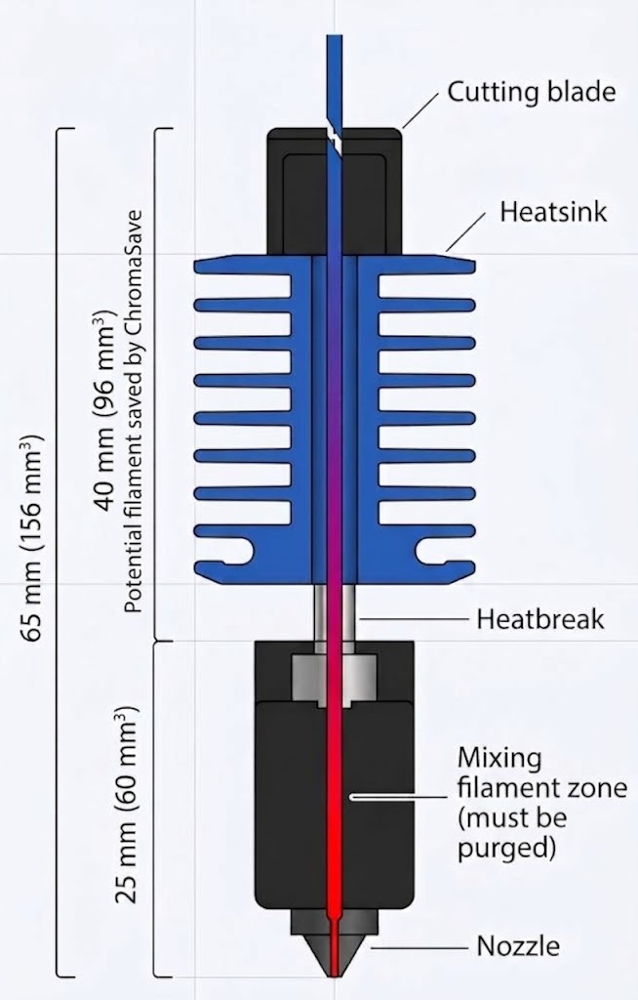
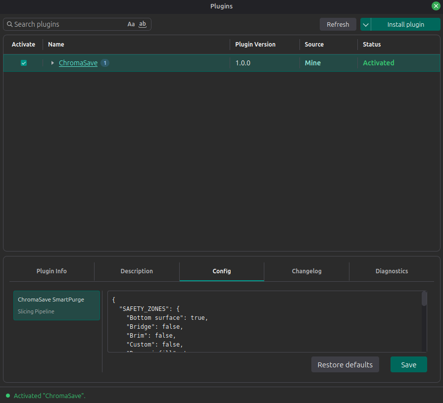
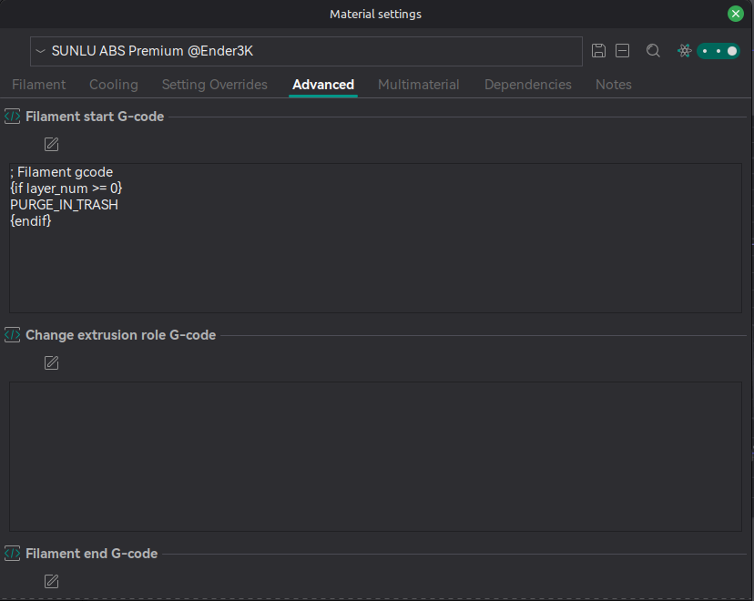
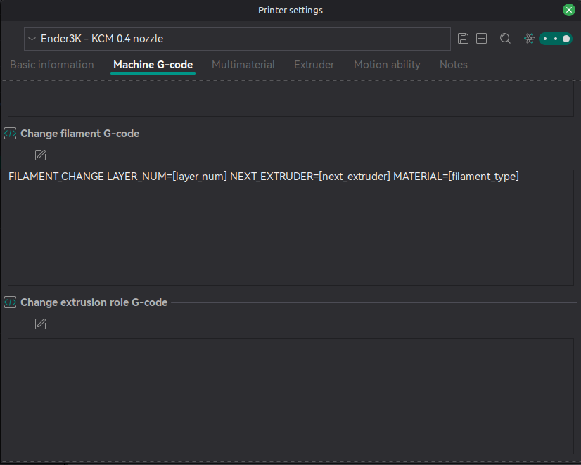
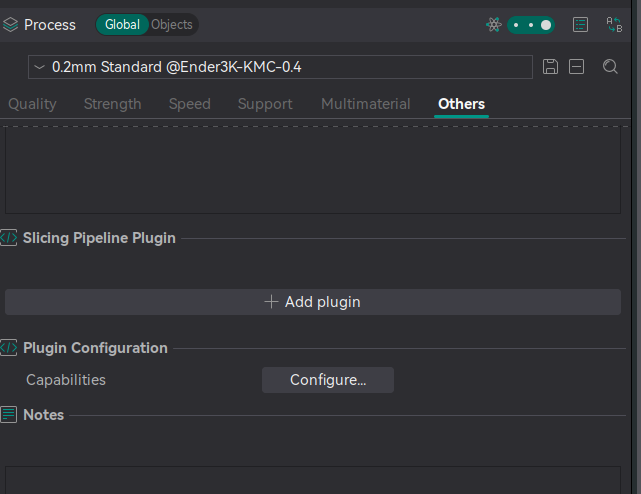
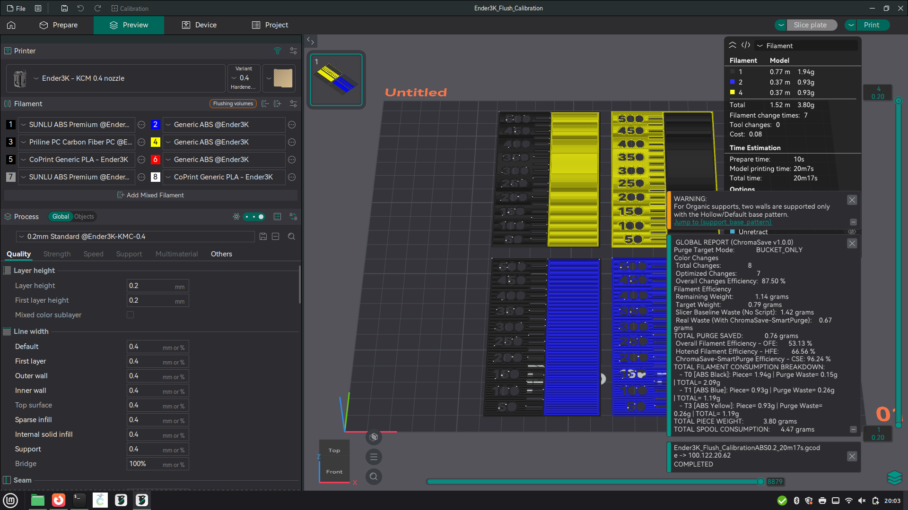

<div align="center">
  
  <p><i>Advanced G-code post-processing plugin for reducing filament waste in multi-color 3D printing.</i></p>

  
  
  
</div>

# ChromaSave (v1.1.0-beta.1)

**ChromaSave** is an open-source post-processing plugin and CLI tool for **OrcaSlicer** designed to minimize multi-color filament purge waste in 3D printers equipped with single-head, multi-color systems—such as the ChromaSet and KCM-Set systems from Coprint3D, which utilize the ChromaHead print head.

By performing **Early Filament Cutting** inside safe internal regions of the model (such as sparse infill, internal solid infill, supports, or the prime tower) and tracking residual melt-zone volume, ChromaSave consumes the remaining filament before the nozzle ever reaches the purge chute.

## What's New in v1.1.0-beta.1 (Bambu Lab Compatibility Update)

This beta release improves reliability and thermal safety for Bambu Lab printers (tested on A1 / A1 Mini G-code) while using both `hybrid` and `bucket_only` purge modes:

* **Safe Multi-Chunk Purging:** Purges exceeding `45.0 mm` are now automatically split into equal chunks separated by inter-flush wipe routines (reusing native OrcaSlicer `; WIPE` sequences or synthesizing a safe wipe using the dynamically detected chute coordinate) to prevent purge chute clogs[cite: 16].
* **Flush Temperature & Header Preservation:** Preserves `M1002`, `M109`, `M106`, and `M400` setup commands from the first flush block so filament purging always runs at the configured flush temperature[cite: 16].
* **Early-Cut State Isolation:** Defers `M104` (nozzle temperature) and `M1007 S0` (mass estimation) from the Early-Cut injection back to the original `Chute Re-route` position, preventing premature temperature changes on previous layers—especially critical for multi-material prints[cite: 16].

> **Note for Beta Testers:** Please monitor the first few toolchanges during physical prints on A1/A1 Mini and report any chute wipe or thermal behavior issues via GitHub Issues.

## 🧠 The Concept

In every color change, there is a portion of filament that could be saved. The remaining length in the ChromaHotend after cutting is 64.87mm (156 mm³), and around 40 mm of this could be saved and printed instead of being purged into a wipe tower or a bucket. For example, if you are printing a model with 300 color changes, there will be 12,000 mm of filament that could potentially be saved. ChromaSave tries to save the maximum quantity of that filament.

<p align="center">
  
</p>

## ⚙️ How It Works

ChromaSave reads the G-code generated by OrcaSlicer and identifies every color change. Based on the amount of filament remaining between the cutter and the hotend (a configurable parameter), it shifts the cutting and filament-change command earlier in the G-code—performing an **"Early Cut."** 

This anticipates the transition, allowing the printer to continue building the part by utilizing some of the filament remaining after the cut, before it mixes with the incoming filament. Any portion of filament that cannot be practically used during a color change is **dynamically and intelligently purged**, ensuring an optimal color transition. The placement of this "Early Cut" is fully configurable, providing complete control for optimization.

### Factory Functionality (Without ChromaSave)
<p align="center">
  
</p>

### ChromaSave Functionality
<p align="center">
  
</p>

*Note: ChromaSave is fully compatible with and complementary to the configurable parameters in OrcaSlicer designed to reduce waste during color changes—such as "Flush into objects' infill", "Flush into objects' support", and "Flush into this object".*

## ✨ Key Features

* **Early-Cut Optimization:** Retroactively places filament cut commands (`M620.11` / `T<n>`) inside authorized internal zones before the scheduled toolchange, consuming the melt-zone plug inside the part or prime tower.
* **Strict Safety Zones (`SAFETY_ZONES`):** Guarantees cuts never occur on visible surfaces (`Outer wall`, `Top surface`, `Overhang wall`, `Bridge`) to prevent color bleeding or surface artifacts.
* **Hybrid & Bucket-Only Purge Modes:**
  * `hybrid`: Combines early-cut consumption + prime tower extrusion + static chute purging, skipping chute purges entirely (`SKIP PURGE`) when the prime tower already covers the flush matrix requirement.
  * `bucket_only`: Deducts early-cut savings directly from the chute purge volume.
* **Minimum Saving Threshold (`min_saving`):** Skips early cuts when the recoverable filament is below a configurable threshold (default: `3.0 mm`), preventing unnecessary cutter wear.
* **Full Physicochemical Accounting:** Parses OrcaSlicer's `flush_volumes_matrix`, `flush_multiplier`, filament diameters, and densities to generate an itemized consumption and savings report at the end of every G-code file and in `chromasave_history.log`.

---

## Prerequisites
* **OrcaSlicer** (v2.5.0+).
* **Open Source 3D Printer** with Klipper and CoPrint3D ChromaHead. 
* **Bambu Lab Printer** with AMS or AMS Lite (e.g., A1, A1 Mini, P1P, P1S, X1C).
* **Prime Tower Enabled:** Strongly recommended (`Process -> Others -> Prime tower -> Enable`) for optimal color transition stability, especially on Layer 1.


## 🛠️ Setup & Installation

### 1. Install the Plugin (OrcaSlicer)
Install and activate the plugin via OrcaCloud or by loading the `.whl` file in the OrcaSlicer Plugins manager.

*Note: You can also use ChromaSave as a post-processing script. Instructions will be provided later.*


### 2. Configure Default Plugin Parameters
Go to the **Config** tab in Plugin Window and configure the default ChromaSave plugin paramters, and click on **Save**. Add the following `.json` configuration:

```json
{
  "SAFETY_ZONES": {
    "Bottom surface": true,
    "Bridge": false,
    "Brim": false,
    "Custom": false,
    "Dense infill": true,
    "Gap fill": false,
    "Inner wall": false,
    "Internal bridge": false,
    "Internal solid infill": true,
    "Outer wall": false,
    "Overhang wall": false,
    "Prime tower": true,
    "Skirt": true,
    "Solid infill": true,
    "Sparse infill": true,
    "Support": true,
    "Support interface": false,
    "Top surface": false,
    "Wipe tower": true
  },
  "aipc": true,
  "len": 64.857,
  "min_saving": 3,
  "purge_target": "hybrid",
  "rem": 5,
  "skip_purge": 2,
  "sm": 20,
  "sre": true
}
```

<p align="center">
  
</p>


**Variables Explanation:**
*   `SAFETY_ZONES`: The G-code zones where you allow ChromaSave to trigger the cut and filament-change command.
*   `aipc`: Avoid in Piece Cut (true/false) – Prevents the `FILAMENT_CHANGE` command within aesthetic zones.
*   `len`: Remaining length (in mm) between the cutter and the hotend tip. (e.g., ChromaHead Nozzle volume (156mm³) = 64.857mm of filament for 1.75mm diameter).
* `min_saving`: Minimum filament saving (mm) required to trigger an early-cut. 
*   `purge_target`: `"hybrid"` or `"bucket_only"` - Defines where the residual purge is directed (hybrid compensates with the wipe tower).
*   `rem`: Retraction margin (in mm) – Safely relocates the `FILAMENT_CHANGE` command.
* `skip_purge` - Minimum length in mm of purge to skip dynamic purge process.
*   `sm`: Safety margin (in mm) to prevent color mixing. For the ChromaHotend, a value of less than 20 mm results in color mixing (corresponds to the length of the hotend block).
*   `sre`: Search Retraction (true/false) - Looks for a retraction command to relocate the `FILAMENT_CHANGE` command within the tolerance window. Must be active with `aipc`.


## 🚀 How to Use with Klipper 3D Printers (OrcaSlicer)

ChromaSave v1.1.0 integrates directly into **OrcaSlicer's Slicing Pipeline Plugin** system (`slicing_pipeline_plugin`).

### 1. Installation
1. Download the `chromasave-1.1.0b0-py3-none-any` plugin package from the [Releases](https://github.com/deathstroke-co/ChromaSave/releases) page.
2. Open **OrcaSlicer** and navigate to your plugin manager / pipeline settings.
3. Install and enable **`ChromaSave`**.

### 2. Klipper Macro Setup
1. Download the [SmartPurge.cfg](./klipper_configs/) macro and upload it to your printer's Klipper configuration folder (usually `~/printer_data/config/`).
2. Inside `SmartPurge.cfg`, adjust the coordinates (`variable_purge_x`, `variable_purge_y`, `variable_wipe_dist`) to match your real physical bucket/brush locations.
3. Ensure you include this config file in your main `printer.cfg` with the following line:
   ```klipper
   [include SmartPurge.cfg]
   ```

*Note: Inside `SmartPurge.cfg` there is an optimized `FILAMENT_CHANGE` macro. If you want use it you must comment or delete the factory `FILAMENT_CHANGE` in `cp_macro.cfg` file. If you don't want to use the optimized macro asure to adapt `SmartPurge.cfg`according to your needs.*

### 3. OrcaSlicer Profile Adjustments
**Filament Settings:**
For every filament in OrcaSlicer, go to the filament settings, navigate to the **Advanced** tab, and add the macro call in the *Filament start G-code* section:
```gcode
; Filament gcode
{if layer_num >= 0}
   PURGE_IN_TRASH
{endif}
```

<p align="center">
  
</p>

**Machine Settings:**
Go to your printer settings, navigate to the **Machine G-code** tab, and replace the *Change filament G-code* with:
```gcode
FILAMENT_CHANGE LAYER_NUM=[layer_num] NEXT_EXTRUDER=[next_extruder] MATERIAL=[filament_type]
```

<p align="center">
  
</p>

### 4. Usage

Go to the **Others** tab in your process profile, scroll down to the **Slicing Pipeline Plugin** section, add the ChromaSave Plugin, and click on **Configure** to setting up the ChromaSave Plugin parameters:

<p align="center">
  
</p>


Slice, print, or save your G-code file as usual. Once the slicing pipeline finishes, you will see a native notification in OrcaSlicer containing the complete ChromaSave report detailing your total purge saved and efficiency metrics.

<p align="center">
  
</p>

<p align="center">
  
</p>

## 🚀 How to Use with Bambu Lab Printers (OrcaSlicer)

ChromaSave v1.1.0 integrates directly into **OrcaSlicer's Slicing Pipeline Plugin** system (`slicing_pipeline_plugin`).

### 1. Installation
1. Download the `chromasave-1.1.0b0-py3-none-any` plugin package from the [Releases](https://github.com/deathstroke-co/ChromaSave/releases) page.
2. Open **OrcaSlicer** and navigate to your plugin manager / pipeline settings.
3. Install and enable **`ChromaSave`**.

### 2. Recommended Configuration Parameters
In the plugin configuration overrides inside OrcaSlicer, configure the parameters according to your hotend's melt-zone length (`len`):

| Parameter | Recommended Value (Bambu A1 / P1 / X1) | Description |
| :--- | :--- | :--- |
| **`len`** | `38.249` / `44.485` / `44.485` mm *(adjust to your cutter-to-nozzle distance)* | Residual filament length below the cutter blade (`mm`). |
| **`sm`** | `15.0` mm | Safety margin subtracted from `len` (`TARGET = len - sm`) to prevent premature color bleed on walls. |
| **`purge_target`** | `hybrid` | Uses Prime Tower + Chute dynamically. Set to `bucket_only` if printing without a prime tower. |
| **`min_saving`** | `3.0` mm | Minimum filament saving required to trigger an Early-Cut. |
| **`skip_purge`** | `2.0` mm | If net chute purge is below this value, replaces pulsatile flushing with a `0.5 mm` prime. |
| **`sre`** | `true` | Snaps cuts to existing retractions and Z-hops when available within `rem` (`5.0 mm`). |
| **`aipc`** | `true` | Enforces `SAFETY_ZONES` so cuts only occur in hidden internal features. |

### 3. Slicing & Verification
1. Slice your multi-color model as usual in OrcaSlicer.
2. Export the G-code file. ChromaSave will automatically post-process the G-code and append a **GLOBAL REPORT** summary block at the bottom of the file.
3. Preview the generated G-code in OrcaSlicer's G-code viewer to verify travel paths before printing.

---

## 🔬 Beta Testing Observations & What to Watch For (Bambu Lab)

Because Bambu Lab printers run proprietary closed-source firmware, we are specifically monitoring **three firmware-level behaviors** during this beta phase. If you test this on a Bambu Lab machine, please pay close attention to:

1. **AMS / AMS Lite State Machine during `Chute Re-route` (`M620` / `M621`):**
   * In `hybrid` mode, when an Early-Cut occurs inside the part, ChromaSave opens `M620 S<n>A`, executes the cut and `T<n>` filament swap, closes `M621 S<n>A` to return to the print bed, and later re-opens `M620 S<n>A` -> `M628` / `M629` -> `M621 S<n>A` at the chute to purge any remaining transition volume without re-issuing `T<n>`.
   * **What to report:** Does the printer execute this second chute purge smoothly, or does the firmware throw an AMS synchronization warning / filament change error?
2. **Static Purge Temperature (`M109` Bypass):**
   * To save time and prevent filament cooking, ChromaSave replaces OrcaSlicer's multi-pulse `FLUSH_START` blocks (which heat up to `flush_temperatures`, e.g., 280 °C for ABS) with a single constant-rate `G1 E<qty> F300` purge at the active layer's printing temperature (e.g., 260–270 °C).
   * **What to report:** Watch for any extruder clicking or partial clogging during high-volume dark-to-light transitions (e.g., Black to White/Yellow) at standard print temperatures.
3. **First-Layer Transition (`[OMITTED: INIT]`):**
   * The very first toolchange of a print never performs an Early-Cut (`[OMITTED: INIT]`) to protect bed adhesion and initialization routines. When using a standard Prime Tower, Layer 1 tower extrusion typically absorbs the full transition matrix volume and triggers `SKIP PURGE` at the chute.
   * **What to report:** Verify that the first color transition on Layer 1 is completely clean before the nozzle touches the model.

---

## How to Submit Beta Feedback

If you encounter any issues, firmware warnings, or have successful print results to share, please open an issue on GitHub with:
1. **Printer Model & Firmware Version** (e.g., Bambu Lab A1 v01.04.xx with AMS Lite).
2. **Material(s) & Profile** (e.g., PLA / ABS / PETG, Nozzle size).
3. **The `GLOBAL REPORT` block** from the end of your processed `.gcode` file (and `chromasave_history.log` if available).
4. **Description of behavior** (especially around Early-Cut return travels and chute purges).

---


## 💡 Recommendations

**Matrix Calibration:** Properly calibrate the Flushing Volumes in the OrcaSlicer Matrix for accurate calculations.

---

## ☕ Support the Project

If you like this tool and it has helped you save some filament, consider buying me a coffee; I would really appreciate it.  

[](https://ko-fi.com/luismlara)

**Copyright (C) 2026 Luis Miguel Lara (deathstroke-co)**  
Licensed under the GNU AGPLv3. See the `LICENSE` file for more details.


## 📄 License

This project is licensed under the **GNU Affero General Public License v3.0 (AGPL-3.0)** — see the [LICENSE](LICENSE) file for details.  
Copyright (C) 2026 **Luis Miguel Lara** (`deathstroke-co`).
