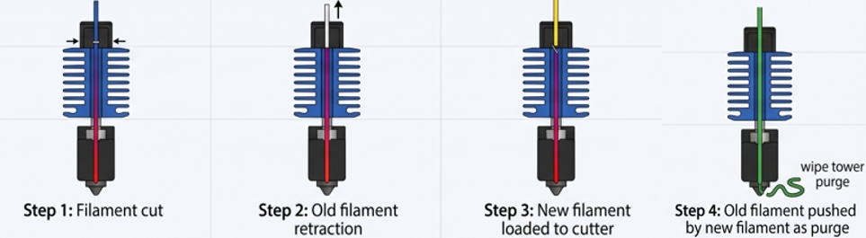
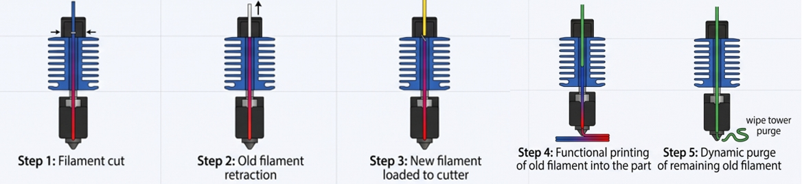
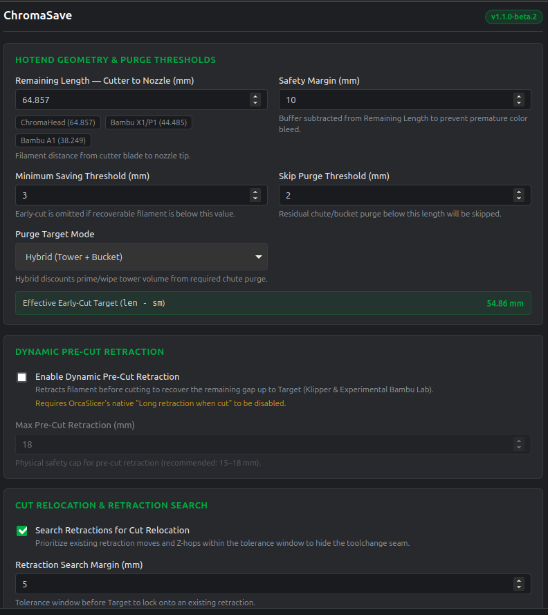
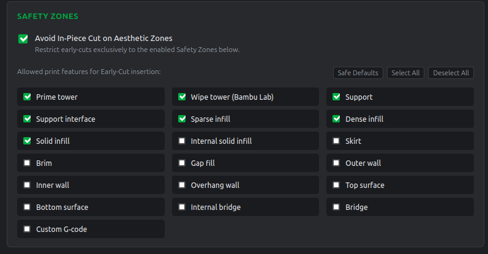

<div align="center">
  

  
  
  
</div>

Slash multi-color purge waste via Early-Cut & Pre-Cut Retraction. ChromaSave optimizes color transitions in OrcaSlicer for single-nozzle multi-color 3D printers (Klipper, Creality SPARKX i7 & Bambu Lab), consuming residual melt-zone filament inside hidden zones before purging to maximize material savings without compromising print quality.

# ChromaSave (v1.1.1)

**ChromaSave** is an open-source **OrcaSlicer** post-processing plugin and CLI tool designed to minimize multi-color purge waste on single-head multi-color 3D printers—including **Klipper** systems (such as CoPrint3D ChromaSet / KCM-Set with ChromaHead), **Creality SPARKX i7**, and **Bambu Lab** printers (A1, A1 Mini, P1P, P1S, X1C).

## What's New in v1.1.1

* **Creality SPARKX i7 Support (Beta):** Pure G-code post-processing via automatic `M8200` detection—no custom Klipper macros required. Includes Early-Cut relocation, native `M8200 R` Dynamic Pre-Cut Retraction, multi-chunk chute purging (`<= 45.0 mm`), `M8200 R E-` long-retraction safety guardrail, and a `63.2 mm` UI preset.
* **Parser Hardening (`M82`/`M83`):** Anchored extrusion-mode regexes prevent `M8200` commands from being misread as `M82` (absolute extrusion).

## What's New in v1.1.0

* **Native Visual Configuration UI:** Replaced raw JSON editing with a self-contained HTML configuration panel inside OrcaSlicer, complete with hotend presets, live effective target calculation (`len - sm`), and visual **Safety Zones** toggles.
* **Dynamic Pre-Cut Retraction (`pre_cut_retract`):** Automatically recovers the remaining gap up to `TARGET` before cutting (capped by `max_pre_cut_retract`, default `18.0 mm`). Fully supported and physically validated in **Klipper** via `SmartPurge.cfg` (`RETRACT_BEFORE_CUT`), and available as an **Experimental** option for **Bambu Lab** (especially beneficial on X1/P1 hotends).
* **Bambu Lab Compatibility & Safety Gate (Beta):**
  * Automatically detects OrcaSlicer's native `Long retraction when cut` (`M620.11 S1`) and safely omits Early-Cut and Pre-Cut Retraction on affected toolchanges (`[OMITTED: LONG_RETRACT]`), preserving native flushing to avoid firmware conflicts.
  * **Safe Multi-Chunk Purging:** Purges exceeding `45.0 mm` are split into equal chunks separated by inter-flush wipe routines to prevent chute clogs.
  * **Flush Header & Thermal Isolation:** Preserves `M1002`, `M109`, `M106`, and `M400` setup commands while restoring layer temperatures cleanly on return travels.
* **Discriminated Reports & Passive Logging:** Reports now break down savings separately into **Early-Cut** and **Pre-Cut Retraction** (excluding initialization toolchange `LAYER_NUM=-1` from efficiency counts) and support optional persistent logging in `~/chromasave_logs/` without requesting OrcaSlicer *Full access*.

## Platform Support & Maturity

| Platform / Feature | Status in `v1.1.1` |
| :--- | :--- |
| **Klipper** (*Early-Cut* + *Dynamic Pre-Cut Retraction* + `SmartPurge.cfg`) | **Stable** *(Physically validated)* |
| **OrcaSlicer HTML Config UI & Passive `DualLogger`** | **Stable** |
| **Creality SPARKX i7** (*Early-Cut* + Native `M8200 R` Pre-Cut Retraction + Multi-Chunk Purge) | **Beta** *(G-code verified; community physical testing)* |
| **Bambu Lab** (*Early-Cut* + Multi-Chunk Purge) | **Beta** *(Community validation)* |
| **Bambu Lab** (*Dynamic Pre-Cut Retraction*) | **Experimental** |


## 🧠 The Concept & How It Works

After every cut, a filament plug remains between the cutter blade and the nozzle tip (e.g., `64.857 mm` / `156 mm³` on a ChromaHead, `~44.5 mm` on Bambu X1/P1, or `~38.25 mm` on Bambu A1). ChromaSave shifts the cut earlier in the G-code (**Early-Cut**) so the printer consumes that plug inside hidden zones, and dynamically retracts any unrecovered gap before cutting (**Pre-Cut Retraction**). Any residual transition volume is then purged accurately based on OrcaSlicer's flush matrix.

<p align="center">
  
</p>

### Factory vs. ChromaSave Workflow

<p align="center">
  
</p>

<p align="center">
  
</p>

*Complementary to OrcaSlicer's built-in "Flush into objects' infill", "Flush into objects' support", and "Flush into this object" options.*

## Prerequisites

* **OrcaSlicer** v2.5.0+
* **Klipper** multi-color printer (e.g., CoPrint3D ChromaHead) **or** **Bambu Lab** printer with AMS / AMS Lite.
* **Prime Tower Enabled** (`Process -> Others -> Prime tower -> Enable`) is strongly recommended for transition stability.

## 🛠️ Installation & Visual Configuration (OrcaSlicer)

1. Install and activate **ChromaSave** from **OrcaCloud** or load `chromasave-1.1.1-py3-none-any.whl` from [Releases](https://github.com/deathstroke-co/ChromaSave/releases) in the OrcaSlicer **Plugins** manager.
2. Go to **Process -> Others -> Slicing Pipeline Plugin**, add **ChromaSave**, and click **Configure**.
3. Adjust your hotend geometry, thresholds, and **Safety Zones** visually and click **Save Configuration**:

<p align="center">
  
</p>

<p align="center">
  
</p>

### Key Parameters

| Parameter | Default | Description |
| :--- | :--- | :--- |
| **Remaining Length (`len`)** | `64.857 mm` | Cutter-to-nozzle filament length (presets included for ChromaHead 64.857, SPARKX i7 63.2, Bambu X1/P1 44.485, Bambu A1 38.249). |
| **Safety Margin (`sm`)** | `10.0 mm` | Buffer subtracted from `len` (`TARGET = len - sm`) to prevent color bleed (`20 mm` recommended for ChromaHead, `10–15 mm` for Bambu Lab). |
| **Min Saving (`min_saving`)** | `3.0 mm` | Minimum recoverable filament required to execute an Early-Cut. |
| **Skip Purge (`skip_purge`)** | `2.0 mm` | Residual chute purge below this value is skipped. |
| **Purge Target (`purge_target`)** | `hybrid` | `hybrid` discounts prime tower extrusion from chute purge; `bucket_only` sends all residual purge to the chute. |
| **Dynamic Pre-Cut Retraction** | `false` | Retracts filament before cutting to recover the remaining gap up to `TARGET` (capped by `max_pre_cut_retract`, default `18.0 mm`). |
| **Retraction Search (`sre` / `rem`)** | `true` / `5.0 mm` | Locks cuts onto existing retractions and Z-hops within the tolerance window. |
| **Safety Zones (`aipc`)** | `true` | Restricts Early-Cuts exclusively to checked internal zones (keeping walls, top surfaces, and bridges clean). |

## 🚀 Klipper Setup (Stable)

1. Download [SmartPurge.cfg](./klipper_configs/) (updated for `v1.1.0` with `RETRACT_BEFORE_CUT` and `SKIP_THRESHOLD` support) into `~/printer_data/config/`.
2. Set your real coordinates (`variable_purge_x`, `variable_purge_y`, `variable_wipe_dist`) and include it in `printer.cfg`:
   ```ini
   [include SmartPurge.cfg]
   ```
   *(If using the optimized `FILAMENT_CHANGE` macro in `SmartPurge.cfg`, comment out or remove the stock `FILAMENT_CHANGE` in `cp_macro.cfg`.)*
3. **OrcaSlicer Filament Start G-code** (*Filament Settings -> Advanced*):
   ```gcode
   ; Filament gcode
   {if layer_num >= 0}
      PURGE_IN_TRASH
   {endif}
   ```
4. **OrcaSlicer Machine Change Filament G-code** (*Printer Settings -> Machine G-code*):
   ```gcode
   FILAMENT_CHANGE LAYER_NUM=[layer_num] NEXT_EXTRUDER=[next_extruder] MATERIAL=[filament_type]
   ```
5. Slice as usual, export or send to print the G-code file. OrcaSlicer will display a native notification with your full savings report and append it to the end of the `.gcode` file.

<p align="center">
  
</p>

## 🔬 Creality SPARKX i7 Setup (Beta)

ChromaSave automatically detects Creality SPARKX i7 G-code (`M8200`). No custom Klipper macros are required.

1. **Important — Disable Native Long Retraction:** Turn **OFF** `Long retraction when cut` in OrcaSlicer (printer and filament profiles). If left enabled, ChromaSave detects `M8200 R E-` and safely omits optimization (`[OMITTED: LONG_RETRACT]`) to avoid double-retraction.
2. Select the **SPARKX i7 (`63.2 mm`)** preset in the ChromaSave UI, set `sm` to `10–15 mm`, and leave `purge_target` on `hybrid`.
3. **Native Dynamic Pre-Cut Retraction:** You may enable `Dynamic Pre-Cut Retraction` (e.g., `max 18.0 mm`) to inject native `M8200 R E-` pre-cut retractions and `G1 E+ F349` post-load recoveries.

> **Beta Testing Notice (SPARKX i7):** G-code generation, kinematics (`G1 X0 F18000` pre-cut park), and purge math are fully verified; physical print validation is currently in community beta. Preview the G-code and monitor the first toolchanges closely.

## 🔬 Bambu Lab Setup (Beta / Experimental)

ChromaSave automatically detects Bambu Lab G-code (`M620 S`). No custom printer macros are required.

1. **Important — Disable Native Long Retraction:** Turn **OFF** `Long retraction when cut` in OrcaSlicer (printer and filament profiles). If left enabled, ChromaSave detects `M620.11 S1` and safely omits optimization on those changes to prevent double-retraction or AMS conflicts.
2. Select your hotend preset in the ChromaSave UI (`44.485 mm` for X1/P1 or `38.249 mm` for A1), set `sm` to `10–15 mm`, and leave `purge_target` on `hybrid`.
3. **Experimental Pre-Cut Retraction:** You may enable `Dynamic Pre-Cut Retraction` (e.g., `max 15–18 mm`) for controlled testing on Bambu Lab printers.

> **Beta Testing Notice (Bambu Lab):** Because Bambu Lab firmware is closed-source, please preview your G-code and monitor the first few toolchanges during physical prints. Watch specifically for:
> 1. Smooth AMS/AMS Lite execution during `Chute Re-route` (`M620` / `M621`) and multi-chunk purges.
> 2. Clean extrusion pressure immediately after `M621` when testing Experimental Pre-Cut Retraction.
> 3. Clean Layer 1 color transitions (TC #1 omits Early-Cut via `[OMITTED: INIT]` to protect bed adhesion).

## 📝 Optional Persistent Logs (No Full Access Needed)

ChromaSave never requires OrcaSlicer *Full access*. Every G-code file already includes the complete `GLOBAL REPORT` at the bottom. If you also want persistent history and console logs:

1. Manually create `~/chromasave_logs`.
2. In OrcaSlicer (**Plugins -> chromasave -> Permissions -> File system -> Read and write**), add `/path/to/your/home/chromasave_logs/*`.

## Feedback, Support & License

* **Feedback & Bug Reports:** Open a [GitHub Issue](https://github.com/deathstroke-co/ChromaSave/issues) with your printer model, firmware version, materials, and the `GLOBAL REPORT` block from your G-code.
* **Recommendation:** Calibrate OrcaSlicer's Flushing Volumes Matrix for accurate purge calculations.
* **Support:** [](https://ko-fi.com/luismlara)

Licensed under the **GNU Affero General Public License v3.0 (AGPL-3.0)** — see [LICENSE](LICENSE).  
Copyright (C) 2026 **Luis Miguel Lara** (`deathstroke-co`).