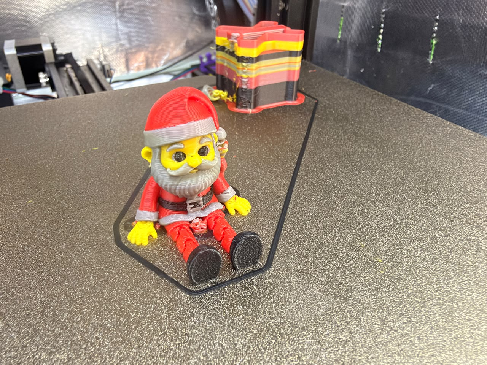
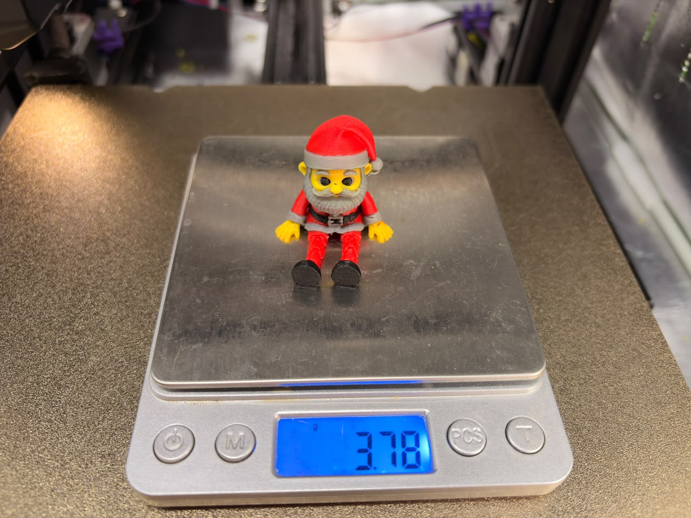
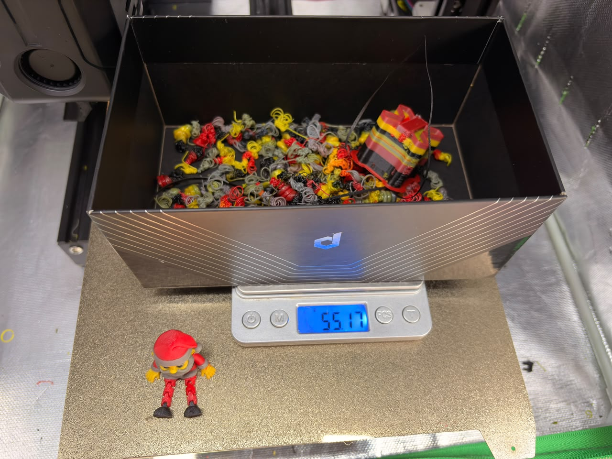
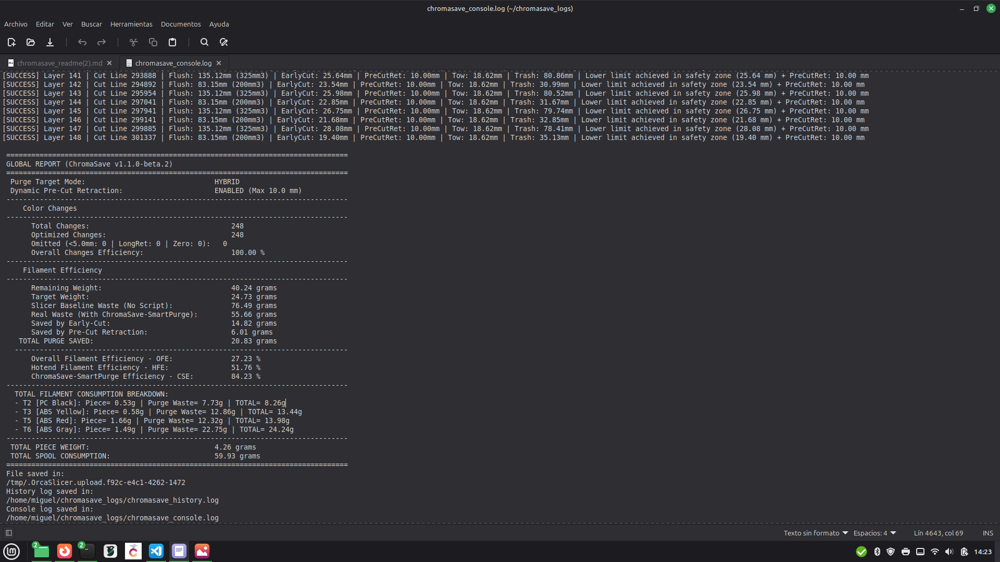

# Physical Validation Test — 4-Color Articulated Santa Claus (Klipper + ABS/PC)

This real-world stress test validates **ChromaSave v1.1.0** (*Early-Cut* + *Dynamic Pre-Cut Retraction* + `SmartPurge.cfg`) on a **Klipper** multi-color printer equipped with a **CoPrint3D ChromaHead**, printing a high-frequency 4-color articulated model in **ABS** and **PC**.

## Test Setup

| Parameter | Value |
| :--- | :--- |
| **Firmware / Hardware** | Klipper + CoPrint3D ChromaHead (`SmartPurge.cfg`) |
| **Slicer** | OrcaSlicer (0.20 mm layer height) |
| **Materials (4-Color)** | `T2` PC Black, `T3` ABS Yellow, `T5` ABS Red, `T6` ABS Gray |
| **Purge Target Mode** | `HYBRID` (Prime Tower + Chute) |
| **Dynamic Pre-Cut Retraction** | `ENABLED` (`max_pre_cut_retract = 10.0 mm`) |
| **Minimum Saving Threshold** | `5.0 mm` |
| **Total Color Changes** | **248** (100% optimized, 0 omitted) |

## Results Summary (Predicted vs. Measured)

| Metric | Slicer Baseline (No ChromaSave) | ChromaSave Predicted | Real Measured (Scale / Klipper) |
| :--- | :--- | :--- | :--- |
| **Purge Waste (Chute + Tower)** | 76.49 g | 55.66 g | **55.17 g** *(0.88% error)* |
| **Finished Model Weight** | 4.26 g *(incl. skirt/supports)* | 4.26 g *(incl. skirt/supports)* | **3.78 g** *(clean figure)* |
| **Total Spool Consumption** | 80.75 g | 59.93 g | **58.95 g** *(23.95 m)* |
| **Total Purge Saved** | — | **20.83 g** *(14.82 g Early-Cut + 6.01 g Pre-Cut Retract)* | **21.32 g** *(vs. baseline)* |
| **Print Time** | 2h 42m 17s *(slicer est.)* | — | **4h 28m 06s** *(Total: 4h 32m 27s)* |

### Efficiency KPIs (248 Toolchanges)

* **Overall Changes Efficiency (OCE):** `100.00%` (`248 / 248` optimized)
* **Overall Filament Efficiency (OFE):** `27.23%` total purge waste reduction
* **Hotend Filament Efficiency (HFE):** `51.76%` of total hotend remaining filament recovered
* **ChromaSave-SmartPurge Efficiency (CSE):** `84.23%` of theoretical target recovered

### Print Time Analysis

The `+1h 45m 49s` difference between OrcaSlicer's estimate (`2h 42m 17s`) and the actual Klipper print time (`4h 28m 06s`) is **not caused by ChromaSave**—it comes from the real mechanical execution time of Klipper's filament-change macros, which the slicer does not model accurately (`~25.6 s` extra per toolchange across 248 swaps ≈ `105 minutes`). In fact, by avoiding the purge of **20.83 g** (~`8.2 m` of filament extruded at `F300`), ChromaSave **saved roughly 25–27 minutes** of purge extrusion time compared to printing the exact same model without the plugin.

## Visual & Scale Evidence

📸 **[View the full photo & timelapse gallery on Imgur](https://imgur.com/a/chromasave-v1-1-0-santa-test-V8jY5is)**

### Finished Model on Build Plate & Scale

<p align="center">
  
  
</p>

Clean high-contrast transitions (**PC Black** → **ABS Yellow** face/hands, **ABS Red** → **ABS Gray** beard/trim) with zero color bleed, zero clogs, and intact articulated joints across 248 swaps.

### Real Measured Waste (Chute Purges + Prime Tower)

<p align="center">
  
</p>

Measured total waste of **55.17 g** vs. **55.66 g** predicted by ChromaSave's physicochemical model (**0.49 g / 0.88% deviation**).

### ChromaSave Console Log & Global Report

<p align="center">
  
</p>

```text
==================================================================================
GLOBAL REPORT (ChromaSave v1.1.0)
==================================================================================
  Purge Target Mode:                               HYBRID
  Dynamic Pre-Cut Retraction:                      ENABLED (Max 10.0 mm)
----------------------------------------------------------------------------------
  Total Changes:                                   248
  Optimized Changes:                               248
  Omitted (<5.0mm: 0 | LongRet: 0 | Zero: 0):      0
  Overall Changes Efficiency:                      100.00 %
----------------------------------------------------------------------------------
  Remaining Weight:                                40.24 grams
  Target Weight:                                   24.73 grams
  Slicer Baseline Waste (No Script):               76.49 grams
  Real Waste (With ChromaSave-SmartPurge):         55.66 grams
  Saved by Early-Cut:                              14.82 grams
  Saved by Pre-Cut Retraction:                     6.01 grams
  TOTAL PURGE SAVED:                               20.83 grams
  --------------------------------------------------------------------------------
  Overall Filament Efficiency - OFE:               27.23 %
  Hotend Filament Efficiency - HFE:                51.76 %
  ChromaSave-SmartPurge Efficiency - CSE:          84.23 %
----------------------------------------------------------------------------------
  TOTAL FILAMENT CONSUMPTION BREAKDOWN:
   - T2 [PC Black]: Piece= 0.53g | Purge Waste= 7.73g | TOTAL= 8.26g
   - T3 [ABS Yellow]: Piece= 0.58g | Purge Waste= 12.86g | TOTAL= 13.44g
   - T5 [ABS Red]: Piece= 1.66g | Purge Waste= 12.32g | TOTAL= 13.98g
   - T6 [ABS Gray]: Piece= 1.49g | Purge Waste= 22.75g | TOTAL= 24.24g
----------------------------------------------------------------------------------
  TOTAL PIECE WEIGHT:                              4.26 grams
  TOTAL SPOOL CONSUMPTION:                         59.93 grams
==================================================================================
```

## Key Takeaways

* **High Volumetric Accuracy:** Predicted waste (`55.66 g`) matched physical scale weight (`55.17 g`) within **0.88%**.
* **Multi-Material Reliability:** 248 consecutive `ABS + PC` toolchanges completed with `RETRACT_BEFORE_CUT=10.00 mm` without heat-creep jams, under-extrusion, or failed filament loads.
* **Time & Material Gains:** Eliminating `20.83 g` of purge waste also shaved **~25–27 minutes** off the actual print time compared to an unoptimized run.
* **Best Practice for Miniatures:** Because this is a stress test with a single `3.78 g` figure and 248 swaps, printing multiple copies on the same plate will amortize the `55.17 g` waste across all parts while keeping the same purge cost.